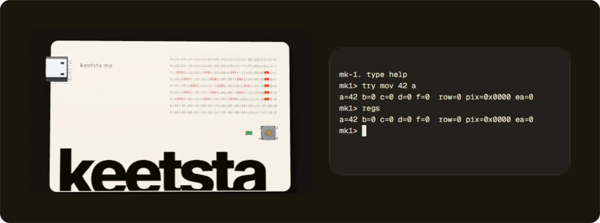
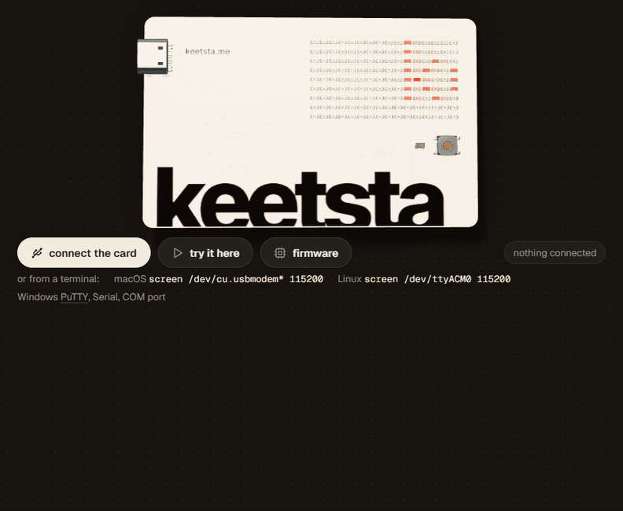

# mk1-web

Use the mk-1 business card from your browser. Open a USB terminal for the physical card or run its shell and virtual chip in WebAssembly.

**[Open mk-1](https://keetsta.me/mk1/)** · [Leaderboard](https://keetsta.me/mk1/top/) · [Firmware source](https://github.com/keetsta/mk1-shell)

<picture>
  <source media="(max-width: 600px)" srcset="docs/media/mk1-web-narrow.webp">
  
</picture>

## Your first browser session

Select **try it here** and enter these commands. `try` runs one instruction on the virtual chip. `regs` shows its current registers, including `a=42`.

```text
try mov 42 a
regs
```

<picture>
  <source media="(prefers-reduced-motion: reduce)" srcset="docs/media/browser-session.webp">
  
</picture>

Run `man` for the chip manual or `tasks` to find a puzzle. The virtual card has a working button and light sensor.

### Connect the physical card

Plug the card in over USB, select **connect the card** in a browser with Web Serial, and choose its serial port. The shell runs on the card and the browser mirrors its LED matrix. The physical card saves its own progress. **try it here** saves progress in the browser.

## From release to card

Open **firmware** and select **install** for the latest release, or choose a local UF2. Pick the card’s bootloader when prompted. With firmware 0.1.2 or later, the installer checks the bootloader ID against the connected card. For older firmware, unplug the other boards, put the intended card into BOOTSEL mode, and confirm the selection.

The installer rejects images that touch saved progress and checks the written bytes before requesting a restart. Reconnect the card to check the installed version. For a UF2 that is safe to copy manually, the page also provides instructions for the `RP2350` drive.

<details>
<summary>How the installer finds a release</summary>

The firmware feed supplies the version, publication date, and SHA-256 for `mk1.uf2`. The browser checks the hash before writing. The GitHub release workflow publishes the UF2 and commit subjects on the release page. It also stores a copy by version and SHA-256 in `firmware-assets` for browser downloads from public releases. [Browse firmware releases](https://github.com/keetsta/mk1-shell/releases).

To use another public repository with the same layout, pass `<Mk1 firmware={{ github }} />`.

</details>

## Publish a card result

After solving your first task on a registered card, run `top`. The web terminal opens the submission form. If you ran `top` in another terminal, open the result link or paste it into the leaderboard. The server reruns the submitted programs and calculates the score.

A nickname is optional. To change it after publishing, run the web terminal with the card on firmware 0.1.2 or later. Keep result links private because they contain your solutions and a submission token.

## Run the site locally

Use Node.js 24 and npm. The `shell/` submodule pins the sources shared by the firmware and the WebAssembly build.

```sh
git submodule update --init
npm ci
npm run dev
```

Run the tests for the virtual shell, serial frames, and firmware installation, then build both pages.

```sh
npm test
npm run build -- --base /mk1/
```

`dist/index.html` serves `/mk1/` and `dist/mk1/top/index.html` serves `/mk1/top/`. The footer shows the build’s Git commit. The React entry points `Mk1` and `Mk1Top` are exported by `src/mk1/`.

<details>
<summary>Rebuild the shell, start the API, or regenerate previews</summary>

- **WebAssembly.** Run `npm run wasm` with Zig 0.16.0. On Windows, use `sh` from Git for Windows. Set `MK1_SHELL_DIR` to test another checkout. Release builds use the pinned submodule.
- **Leaderboard API.** The dev server proxies requests to `127.0.0.1:8787`. Set `MK1_API_ORIGIN` to change that address. [Start the service](https://github.com/keetsta/mk1-shell/blob/main/server/README.md).
- **Card geometry.** Run `npm run geometry` with `kicad-cli` to regenerate the geometry and SVGs in `src/mk1/preview/` from `../mk1-card`.
- **Screenshots.** Start `npm run preview` and run `node tools/shot.mjs shots` in another terminal. Pass `card`, `update`, `firefox`, `nousb`, `silent`, or `busy` as the second argument to select a scenario.

</details>

## Deploy and roll back

The [deployment workflow](.github/workflows/deploy.yml) runs on pushes to `main` and can also be started manually. It rebuilds WebAssembly from the pinned submodule, runs the tests, and deploys the static pages over SSH.

The deployment key can only upload releases under `/srv/mk1-web/main`. Caddy serves the release linked by `current`. The [receiver](deploy/receive.py) keeps the five most recent releases.

```sh
sudo -u mk1-deploy /srv/mk1-web/bin/receive main list
sudo -u mk1-deploy /srv/mk1-web/bin/receive main rollback <release>
```

The workflow uses `SHELL_READ_KEY` to read mk1-shell. The `main` environment provides `DEPLOY_SSH_KEY`, `DEPLOY_KNOWN_HOSTS`, and `DEPLOY_HOST`.

## License

The original code and documentation are [MIT licensed](LICENSE). npm dependencies, [Lucide](https://lucide.dev/license), and [Simple Icons](https://github.com/simple-icons/simple-icons/blob/develop/LICENSE.md) have their own licenses. The WebAssembly module follows the mk1-shell license terms.
